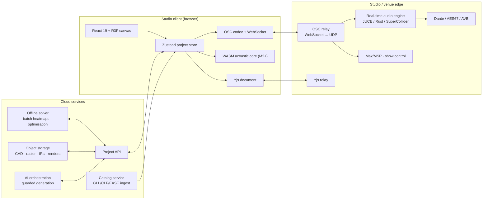

# AURA-SPEC · System Blueprint

**Status:** M0 architecture and scaffold  
**Audience:** principal architects, acoustic engineers, DSP/audio leads, creative technologists  
**Normative companion:** `packages/core-acoustics/src/types/` and `docs/01-acoustics.md`

---

## 1. Vision and cultural context

AURA-SPEC is a design instrument for **sound as space-making**. It inherits a lineage that treats landscape, architecture, psychoacoustics and dramaturgy as one material system: the garden as a score, the façade as a radiator, the listener as a moving participant, the loudspeaker as a sculptural object rather than a black box on a bracket.

The brief names a specific heritage — Giardino Sonoro, Musst Design, Mindkestra and Lorenzo Brusci's philosophical/aesthetic work — and two hardware poles: **Architettura Sonora** (sculptural, natural-material, point-source and omnidirectional objects) and **K-ARRAY** (slim line arrays, electronic beam steering, architectural subwoofers, surface transducers). The platform must make both poles first-class without flattening either into a generic "speaker box".

The product thesis:

> Existing PA CAD tools answer "will the coverage be loud enough?" AURA-SPEC must also answer "what world does this sound make, who can enter it, and how does it change over time?"

That requires four capabilities to coexist in one document model:

1. **Physical acoustics** — geometry, materials, polar dispersion, propagation, room response.
2. **Hardware specification** — transducers, amplification, mounts, weather, network, power.
3. **Spatial composition** — sources, trajectories, renderers, zones, live performers, AI agents.
4. **Collective authorship** — distributed editing, provenance, consent, versioning, performance.

The platform is therefore not a single application but a **family of runtimes over a shared acoustic contract**: a browser studio, an offline solver, a real-time audio engine, a catalog service and a collaboration relay.

---

## 2. Product principles

| Principle | Consequence |
|---|---|
| **Deterministic core** | Every acoustic number is reproducible from a serialised project + catalog snapshot + code version. No hidden model calls in the signal path. |
| **Physical honesty** | Directivity, distance, air absorption, phase and room contribution are explicit. Approximations are labelled as approximations. |
| **Open catalog, closed provenance** | Anyone can add a speaker profile; every profile declares its source, licence, verification level and checksum. |
| **Composition, not just coverage** | Sources have trajectories, spread, dramaturgical roles and relationships; a heatmap is one view, not the product. |
| **Human authority over AI** | Generative agents propose; humans approve. SPL, content and duration guardrails are enforceable at the renderer. |
| **Local-first, collaborative** | A single architect can work offline; a team can merge through CRDTs when connected. |
| **Hardware-aware** | A visual decision immediately yields cable, amplifier, IP, power and network consequences. |
| **Venue-deployable** | The same project can export to Max/MSP, SuperCollider, a CLAP/VST plugin, a Dante/AES67 network and a show-control system. |

---

## 3. Capability map

### A. Spatial and ingestion pipeline

- Vector/CAD: DWG/DXF parsing, vector PDF floor plans with scale calibration.
- Raster: PNG/JPG sketches, two-point scale calibration, assisted boundary tracing.
- 2.5D/3D generation: footprint extrusion, wall/ceiling/floor classification, openings.
- Material assignment: octave-band absorption, scattering, transmission loss; zone overrides.
- Layer model: CAD reference, raster reference, acoustic surfaces, speakers, listeners, annotations, AI agents.

### B. Acoustic and polar dispersion engine

- Manufacturer polar balloons: azimuth/elevation isobars, frequency-dependent attenuation.
- Directivity models: measured grid, real spherical harmonics, parametric omni/cardioid/lens/line-array.
- Line-source behaviour: cylindrical near field, spherical far field, electronic steering, grating lobes.
- Metrics: direct SPL, D/R, STI estimate, C50, phase alignment, coverage uniformity, spatial overlap.
- Real-time heatmaps on listener planes and arbitrary receiver meshes.

### C. Hardware and infrastructure specification

- Transducer BOM, accessories, mounts, weather-proofing, IP compatibility.
- Amplification: low-Z, 70 V, 100 V, self-powered; impedance and power budgets.
- Network: Dante, AES67, Ravenna, AVB/Milan; channel count, flows, switch requirements, latency budget.
- Commissioning export: channel maps, delay/trim tables, DSP presets, cable schedules.

### D. Software spatialisation and co-composition

- Renderers: HOA up to 7th order, VBAP, DBAP, WFS approximations, binaural monitoring.
- Source trajectories, field morphing, zoned acoustics, distance/spread encoding.
- Live inputs: OSC, MIDI, WebRTC/SIP audio, sensor streams.
- AI agents: procedural Foley, spectral ambience, reactive drones, narrative/co-composition roles.
- Distributed workflow: CRDT document, presence, comments, approvals, render/export jobs.

---

## 4. System architecture



### 4.1 Runtime separation

| Runtime | Responsibility | Must not do |
|---|---|---|
| **Studio client** | Authoring, visualisation, interaction, local preview | Own sample-accurate audio rendering |
| **Acoustic core** | SPL, polar sampling, heatmaps, metrics, BOM rules | Perform I/O or depend on UI |
| **Real-time audio engine** | Sample-accurate spatialisation, DSP, Dante/AVB output | Block on network or UI |
| **OSC bridge** | State diffusion, clock, protocol adaptation | Be the source of acoustic truth |
| **Catalog service** | Versioned manufacturer data, provenance, asset storage | Silently "clean" measured data |
| **Collaboration relay** | CRDT sync, awareness, persistence | Resolve semantic conflicts by force |
| **AI orchestration** | Proposal generation, model routing, guardrails | Write directly to the audio output |

The **acoustic core is the single source of truth** for geometry/math. Shaders and native engines consume derived data (atlases, coefficients, delay tables); they do not reimplement different formulas.

### 4.2 Browser compute strategy

M0 uses TypeScript for clarity and testability. The hot paths are:

- polar grid sampling and SH fitting,
- heatmap evaluation (receiver grid × sources × bands),
- coverage optimisation (M2+),
- real-time balloon vertex displacement.

M1/M2 plan:

1. Keep the TypeScript reference implementation as the executable specification.
2. Port the inner loops to Rust → WASM with the same test vectors.
3. Use Web Workers for heatmaps and SH fitting; keep the render loop at 60 fps.
4. Move to WebGPU compute only when the data volume justifies it; the contracts stay identical.

### 4.3 Real-time audio strategy

Three viable engines, in order of strategic fit:

1. **Native Rust or C++ engine** (CPAL/JUCE + custom DSP): lowest latency, portable to venue hardware, best long-term control.
2. **JUCE plugin + standalone**: fastest path to CLAP/VST3 and Dante/ASIO integration; good for DAW co-composition.
3. **SuperCollider / Max bridge**: fastest prototyping and show-control integration; less suitable as the sole shipping engine.

The OSC bridge is deliberately engine-agnostic. The renderer contract is "receive source state and clock; produce N channels at sample rate S with a declared latency L".

---

## 5. Technology stack

### 5.1 Frontend and interaction

| Concern | Choice | Rationale |
|---|---|---|
| UI framework | React 19 + TypeScript | Ecosystem, accessibility, team familiarity |
| 3D canvas | Three.js via React Three Fiber | Declarative scene graph, shader access, large ecosystem |
| GPU path | WebGL2 now, WebGPU renderer later | WebGL2 is universal; WebGPU for compute-heavy heatmaps |
| 2D plan editor | Canvas/SVG first; PixiJS if millions of vectors | Keep the MVP dependency-light; choose after DXF/PDF profiling |
| State | Zustand for ephemeral UI; Yjs for shared truth | Clear separation between view state and document state |
| Styling | Plain CSS modules / custom properties | No design-system dependency in M0 |
| Charts | Lightweight custom canvas | Avoid a charting library in the 3D viewport |

### 5.2 Acoustic and spatial core

| Concern | M0 | M2+ |
|---|---|---|
| Language | TypeScript (dependency-free) | Rust → WASM for hot loops |
| Polar import | CSV/TSV + API for GLL/CLF | Native GLL/CLF parser, EASE import |
| Geometry | Simplified planes/boxes/extrusions | Robust CAD/BIM kernel (e.g. OpenCascade via WASM/native) |
| Optimisation | Greedy/manual | Constrained optimisation, genetic search, gradient-free |
| Metrics | Direct SPL, D/R, STI estimate, C50, phase | Auralisation, ray tracing, hybrid image-source |

### 5.3 Data and cloud

| Concern | Choice | Notes |
|---|---|---|
| Primary database | PostgreSQL + PostGIS | Project metadata, geometry indexing, catalog |
| Document storage | JSONB + object storage | Canonical project JSON; large assets in S3-compatible storage |
| Collaboration | Yjs + WebSocket relay | CRDT for source/placement fields; periodic snapshots |
| Cache / presence | Redis | Awareness, rate limits, ephemeral render jobs |
| Messaging | NATS or Redis Streams | Solver jobs, catalog sync, AI generation events |
| Search | Postgres full-text first | Avoid Elasticsearch until catalogue size demands it |
| Auth | OIDC + RBAC | Studio, editor, viewer, venue operator, catalog admin |
| Observability | OpenTelemetry | Trace import → solve → export; log model/version |

### 5.4 Protocol and hardware

- **OSC 1.0** as the lowest common denominator; bundles with NTP timetags for scheduling.
- **WebSocket** between browser and local relay; **UDP** from relay to audio hosts.
- **Dante** control requires the Audinate SDK/licensing; the platform treats Dante as an external certified integration, not a reverse-engineered protocol.
- **AES67/Ravenna/AVB** are modelled at the flow/channel/latency level; final commissioning uses vendor tools.
- **MIDI 2.0 / MPE** for expressive controllers; **WebRTC/SIP** for remote performers.

---

## 6. Data and collaboration architecture

### 6.1 Canonical documents

```
AuraProjectDocument
├── environment: ArchitecturalEnvironment
├── session: SpatialAudioSession
├── speakerProfiles: AcousticSpeakerProfile[]   # pinned snapshot
├── schemaVersion
├── contentHash
└── timestamps
```

The project pins the **exact catalog revision** used for a design. A later catalog update must not silently change an approved project.

### 6.2 CRDT model

Yjs is used for fields that benefit from concurrent editing:

```
meta        Y.Map   session identity, schema version
sources     Y.Map<Y.Map>   scalar fields + Y.Array position/orientation
placements  Y.Map<Y.Map>   speaker position/orientation/gain/delay
renderer    Y.Map
transport   Y.Map
```

Geometry and material edits are heavier. M0 stores them as **atomic JSON values** in a `Y.Map` with last-writer-wins semantics per surface; M2 introduces a geometry-aware merge policy (e.g., split/merge operations with stable IDs).

### 6.3 Conflict semantics

| Data | Merge policy | Reason |
|---|---|---|
| Source position | Per-axis CRDT array merge | Continuous, frequent, commutative |
| Gain/delay/trim | Last writer wins with audit trail | Simple, reversible |
| Speaker placement | Per-field LWW | Avoid interleaving x from one user and y from another |
| Geometry vertex | LWW per vertex with lock for structural edits | Prevent invalid topology |
| Material assignment | LWW + revision note | Easy to review |
| AI prompt/parameters | LWW + approval state | Human authority |
| Catalog profile | Immutable version | Reproducibility |

### 6.4 Serialisation

- Canonical JSON: sorted object keys, fixed number formatting, no `NaN`/`Infinity`.
- `contentHash = SHA-256(canonical JSON)`; stored with every approved revision.
- Large binaries (CAD, IRs, renders) are content-addressed blobs with SHA-256.
- Schema migrations are explicit, versioned, and tested against golden fixtures.

---

## 7. Catalog and hardware architecture

### 7.1 Catalog ingestion

```
Manufacturer files
  GLL / CLF / EASE / CSV / PDF datasheet
        ↓
  format adapter + checksum
        ↓
  normaliser (bands, angles, units, orientation)
        ↓
  validator (grid completeness, on-axis normalisation)
        ↓
  derived artefacts (SH coefficients, texture atlas, directivity index)
        ↓
  versioned catalog profile + provenance
```

The platform must preserve the original file and a parser version. A manufacturer correction is a new revision, never an in-place mutation.

### 7.2 Hardware graph

A project contains a directed graph:

```
Source → Bus → Renderer → OutputChannel → AmplifierChannel → Loudspeaker
                                   ↘ NetworkFlow (Dante/AES67)
```

The BOM is a projection of this graph plus engineering rules. It is not a separate spreadsheet.

### 7.3 First-order infrastructure rules

- Low-Z: total RMS × headroom → amplifier allowance; parallel impedance check per channel.
- 70/100 V: tap sum × 1.25 → amplifier VA; transformer loss and line loss flagged.
- Weather: zone exposure × IP rating; outdoor cable and connector schedule.
- Network: channel count × sample rate × bit depth × overhead; PTP/IGMP/QoS requirements.
- Latency: AD + switch hops + DSP + DA ≤ show target; report the budget, not just a number.

These rules are deliberately explainable. A future "auto-select amplifier" feature must show its constraints and allow override.

---

## 8. AI dramaturgy and co-composition

AI is modelled as a **node in the composition graph**, not a chat sidebar:

```
sensor / prompt / score / live input
        ↓
  AI generative node (role, model, seed, guardrails)
        ↓
  audio bus + spatial source + trajectory
        ↓
  human approval / rehearsal / performance
```

Guardrails:

- maximum SPL per zone and per node,
- maximum duration and fade-out,
- content policy and attribution,
- explicit human approval for public performance,
- deterministic seed and model version for reproducibility,
- offline fallback to a local procedural patch.

The platform should support **reactive** agents (weather, occupancy, light) and **generative** agents (Foley, drones, spectral beds), but it should not collapse the distinction between a composed sound object and an algorithmic process. The document stores both.

---

## 9. Performance budgets

| Operation | Target | Notes |
|---|---|---|
| Studio frame rate | 60 fps at 1080p | 200 speakers, 20 balloons, one heatmap |
| Balloon update | < 16 ms | Atlas cached per profile/band; only uniforms change |
| Heatmap 0.5 m grid, 400 m², 20 sources | < 250 ms off main thread | Worker + typed arrays |
| Polar parse, 37 × 19 × 9 | < 50 ms | Precomputed IDW neighbourhoods |
| SH fit order 4 | < 100 ms | Normal equations; move to WASM if larger |
| OSC publish | 30–60 Hz per session | Diff only; bundle at target cadence |
| Audio engine latency | ≤ 10 ms venue target | Depends on Dante/AVB and host |
| Collaboration sync | < 100 ms LAN | Yjs updates, awareness separate |

---

## 10. Security, licensing and ethics

- **Manufacturer data**: GLL/CLF files and measured balloons are licensed assets. Store the licence and redistribution policy; do not expose restricted files to viewers.
- **Project IP**: owner/editor/viewer roles, audit log, export watermarking, rights semaphore for third-party content.
- **Personal data**: occupancy/vision sensors must be consent-gated and edge-processed where possible; store aggregates, not raw video, unless explicitly authorised.
- **AI**: provider allow-list, prompt/response retention policy, no unapproved voice cloning, no covert generation, SPL limits.
- **Safety**: the renderer enforces maximum output; the UI warns about infrasound, ultrasonic content, feedback and hearing exposure.
- **Venue**: export a commissioning pack that includes limiters, presets, cable/network schedules and a rollback plan.

---

## 11. Principal risks

| Risk | Impact | Mitigation |
|---|---|---|
| Polar data licensing blocks catalog scale | High | Start with open/measured profiles; keep import adapters format-agnostic; legal review per manufacturer |
| CAD/BIM geometry is messy | High | Treat import as assisted, not magic; require scale calibration and human review; store confidence |
| Real-time engine and browser diverge | High | Shared test vectors; export delay/trim tables; contract tests |
| CRDT conflicts corrupt geometry | Medium | Lock structural edits; LWW for vertices; snapshot + review |
| AI output violates artistic or legal constraints | High | Guardrails, approvals, provenance, ability to disable |
| Network latency breaks co-performance | Medium | Local monitoring, latency budget, fallback to click track |
| GPU float textures unavailable | Low | Fallback to 8-bit RGBA atlas + CPU balloon |
| Over-scoping the MVP | High | Enforce the vertical slice; no new subsystem before import→heatmap→OSC is trustworthy |

---

## 12. Immediate next steps

1. **M1 import spike**: DXF floor plan + two-point raster calibration + scale verification.
2. **Catalog ingest**: GLL/CLF normaliser with a golden-file test; replace illustrative data.
3. **Heatmap worker**: move `sampleListenerPlane` off the main thread and add progress/cancellation.
4. **OSC relay**: WebSocket → UDP with backpressure, target health and bundle timetags.
5. **Real-time sink**: a minimal 8-channel test engine (SuperCollider/JUCE) proving the address space and latency budget.

The scaffolding in this repository is intentionally small enough to audit. The next milestone should add capability without weakening the contracts.
