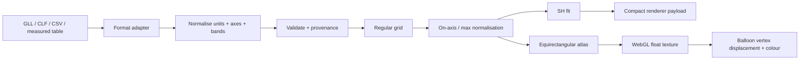

# Polar Parser → Spherical Matrix → WebGL

This module turns manufacturer polar tables into data the acoustic engine and the GPU can share. It is the technical heart of "the loudspeaker as a sculptural radiator" rather than a generic point source.

Implementation:

```
packages/core-acoustics/src/polar/parser.ts
packages/core-acoustics/src/polar/grid.ts
packages/core-acoustics/src/polar/spherical-harmonics.ts
packages/core-acoustics/src/polar/texture.ts
packages/core-acoustics/src/polar/glsl.ts
```

Demo: `apps/studio-web/src/scene/PolarBalloon.tsx`.

---

## 1. Pipeline



The grid is authoritative. SH and the texture are derived caches. If a manufacturer corrects a measurement, invalidate both caches.

---

## 2. Input formats

### 2.1 CSV / TSV layouts

The parser supports four common layouts.

**A. One elevation plane, azimuth rows**

```csv
# normalization: on-axis-0db
# reference_distance_m: 1
azimuth_deg,63,125,250,500,1000,2000,4000,8000
-180,-18,-16,-14,-12,-10,-9,-8,-10
-90,-6,-5,-5,-4,-4,-4,-5,-6
0,0,0,0,0,0,0,0,0
90,-6,-5,-5,-4,-4,-4,-5,-6
180,-18,-16,-14,-12,-10,-9,-8,-10
```

**B. Full balloon, azimuth + elevation + frequencies**

```csv
azimuth_deg,elevation_deg,1000,2000
-90,-45,-12,-14
-90,0,-6,-7
-90,45,-12,-14
0,-45,-3,-4
0,0,0,0
0,45,-3,-4
90,-45,-12,-14
90,0,-6,-7
90,45,-12,-14
```

**C. Elevation plane, elevation rows**

```csv
elevation_deg,1000
-90,-30
-45,-8
0,0
45,-8
90,-30
```

**D. Frequencies as rows, angles as columns**

```csv
Hz,-180,-135,-90,-45,0,45,90,135,180
63,-18,-14,-10,-6,0,-6,-10,-14,-18
1000,-24,-18,-12,-6,0,-6,-12,-18,-24
```

Headerless numeric matrices are also accepted when the first row is frequencies and the first column is azimuth.

### 2.2 Metadata keys

Comments beginning with `#` or `//` are parsed as `key: value`:

| Key | Meaning | Default |
|---|---|---|
| `normalization` | `on-axis-0db`, `max-0db`, `absolute` | `on-axis` |
| `reference_distance_m` / `distance_m` | measurement distance | `1` |
| `angle_unit` | `deg` or `rad` | `deg` |
| `value_unit` / `units` | `db` or `linear` | `db` |
| `elevation_deg` | default elevation for layout A | `0` |
| `azimuth_deg` | default azimuth for layout C | `0` |
| `delimiter` | `,`, `\t`, `;`, `|` | auto-detect |

Unrecognised metadata is preserved in the returned `metadata` map.

### 2.3 Angle conventions

- Azimuth `0°` = local +Z (front); `+90°` = local +X (right).
- Elevation `0°` = horizontal; `+90°` = local +Y (up).
- The parser accepts `-180..180` or `0..360`; it sorts and wraps.
- A measurement spanning less than 300° of azimuth generates a warning: the missing rear sector is interpolated, not measured.

---

## 3. Parser behaviour

`parsePolarTable(text, options)` returns:

```ts
interface ParsedPolarTable {
  grid: PolarGrid
  metadata: Record<string, string>
  warnings: string[]
}
```

Steps:

1. Strip comments; collect metadata.
2. Detect delimiter and header.
3. Identify angle and frequency columns.
4. Convert radians to degrees and linear amplitude to dB (`20 log10`).
5. Build raw samples `(azimuth, elevation, frequency, valueDb)`.
6. Infer unique angle/frequency axes.
7. Resample missing cells with **inverse-distance weighting** on the sphere.
8. Normalise on-axis or max.
9. Validate sizes and finiteness.

### 3.1 Why IDW, not naive bilinear fill

Manufacturer tables are often irregular: coarse at the rear, dense near the axis, or missing a pole. IDW with a small neighbourhood:

```
w_i = 1 / (d_i² + ε)
D(θ,φ) = Σ w_i D_i / Σ w_i
```

preserves measured values (exact hits short-circuit) and avoids inventing a smooth surface where there is no data. It is a **fill** strategy, not a replacement for a proper spherical triangulation. M2 will add a Delaunay/quad-edge mesh for arbitrary grids.

### 3.2 Grid resolution

The parser can resample to a regular grid:

```ts
const { grid } = parsePolarTable(csv, {
  gridResolutionDeg: 5,
  idwNeighbours: 6,
})
```

A 5° grid is 72 azimuths × 37 elevations = 2,664 cells per band. At 9 bands that is ~24k floats per profile, small enough for CPU and GPU.

### 3.3 Normalisation

- `on-axis`: subtract the value sampled at `(0°, 0°)` per band.
- `max`: subtract the maximum per band.
- `none`: preserve absolute SPL.

The propagation engine expects relative directivity. If `normalization === "absolute"`, `sampleDirectivityDb` subtracts the on-axis value before use.

---

## 4. Spherical-harmonic fit

`fitSphericalHarmonics(grid, order)` returns:

```ts
interface SphericalHarmonicSet {
  order: number
  frequenciesHz: number[]
  coefficients: number[][]   // [band][coefficient]
  normalization: DirectivityNormalization
}
```

The fit solves a regularised least-squares problem per band:

```
(AᵀA + λI) c = Aᵀ y
```

- `A` is the sampled real-SH basis,
- `y` is the dB balloon,
- `λ = 1e-6` by default.

Coefficient ordering is `l = 0..N`, `m = −l..l`. The number of coefficients is `(N+1)²`:

| Order | Coefficients | Typical use |
|---|---|---|
| 1 | 4 | omni/cardioid approximation |
| 2 | 9 | smooth balloon preview |
| 3 | 16 | interactive renderer |
| 4 | 25 | high-quality balloon |
| 7 | 64 | research / HOA-adjacent |

### 4.1 Fit in dB or amplitude?

The M0 implementation fits dB. This is perceptually convenient and stable for display, but it is not energy-optimal. A future option will fit linear amplitude or energy with a non-negativity constraint. Document which domain a coefficient set uses; do not mix them.

### 4.2 Evaluation

```ts
const db = evaluateSphericalHarmonics(sh, azimuthDeg, elevationDeg, frequencyHz)
```

Frequency interpolation is logarithmic between the fitted bands. Outside the measured range the nearest band is used, and the parser should have warned.

---

## 5. Equirectangular texture atlas

`bakePolarAtlas(grid, options)` produces a GPU-ready atlas:

```ts
interface PolarAtlas {
  width: number
  height: number
  bandCount: number
  floatData?: Float32Array       // width × height × bandCount, 0..1
  rgbaData?: Uint8Array          // width × height × ceil(bands/4) × 4
  minDb: number
  maxDb: number
  format: 'float' | 'uint8-rgba'
  layout: 'equirectangular-atlas'
}
```

### 5.1 Mapping

For texel `(col, row)`:

```
azimuth   = −180 + (col + 0.5) / width  · 360
elevation =   90 − (row + 0.5) / height · 180
```

Top row = +90° elevation; left column = −180° azimuth.

Band `b` is stored at:

```
v = (row + b · height) / (height · bandCount)
```

The shader uses `NEAREST` filtering and performs manual bilinear interpolation in angle. This avoids bleeding between adjacent bands at atlas boundaries.

### 5.2 Decode

```
D_dB = mix(minDb, maxDb, encoded)
D_linear = 10^(D_dB / 20)
```

The float atlas uses `R32F`/`R16F`. For WebGL1 or constrained hardware, the RGBA atlas packs four bands per texel; the trade-off is 8-bit quantisation.

### 5.3 Memory

A 128 × 64 atlas × 9 bands:

- float32: `128 · 64 · 9 · 4 ≈ 294 kB` per profile,
- RGBA8: `128 · 64 · 3 · 4 ≈ 98 kB` per profile.

At 200 speakers sharing 20 profiles, the atlas cache is small. Cache by `profileId + band + normalization`.

---

## 6. GLSL sampling

`POLAR_TEXTURE_GLSL` provides:

- `auraAtlasTexel(col,row,band)` — decode one texel,
- `auraPolarDb(azElDeg)` — manual bilinear sample with azimuth wrap,
- `auraPolarLinear(azElDeg)` — linear gain,
- `auraPolarColor(db)` — display palette.

`POLAR_BALLOON_GLSL` adds:

```glsl
vec3 auraBalloonPosition(vec3 unitDirection) {
  float azimuth = degrees(atan(unitDirection.x, unitDirection.z));
  float elevation = degrees(asin(clamp(unitDirection.y, -1.0, 1.0)));
  float gain = auraPolarLinear(vec2(azimuth, elevation));
  float radius = 0.25 + 0.75 * gain;
  return unitDirection * radius;
}
```

The studio uses a `ShaderMaterial` with:

```ts
uniforms: {
  uPolarAtlas, uPolarWidth, uPolarHeight,
  uPolarBands, uPolarBand,
  uPolarMinDb, uPolarMaxDb,
}
```

The vertex shader displaces a unit sphere; the fragment shader colours by dB. This is a **preview** of the balloon, not the acoustic calculation.

---

## 7. API example

```ts
import {
  parsePolarTable,
  bakePolarAtlas,
  fitSphericalHarmonics,
  samplePolarGridDb,
} from '@aura-spec/core-acoustics'

const { grid, warnings } = parsePolarTable(csvText, {
  gridResolutionDeg: 5,
  normalization: 'on-axis',
  referenceDistanceM: 1,
})

const atlas = bakePolarAtlas(grid, { width: 128, height: 64, minDb: -36, maxDb: 0 })
const sh = fitSphericalHarmonics(grid, 3)

const onAxis = samplePolarGridDb(grid, 0, 0, 1000)
const atRight = samplePolarGridDb(grid, 90, 0, 1000)
```

---

## 8. Failure modes and diagnostics

| Symptom | Cause | Action |
|---|---|---|
| All values 0 dB | wrong normalization or column mapping | Inspect `metadata`, print raw samples |
| Rear sector flat | measurement only covers front | Warning; do not use for omni claims |
| Balloon has a seam | azimuth wrap or duplicate 180/−180 | Normalise the axis; remove duplicates |
| Low-frequency balloon looks wrong | absolute vs relative dB | Check `normalization` |
| GPU balloon is blocky | atlas too small or NEAREST | Increase atlas or use SH |
| SH fit oscillates | order too high for sparse data | Reduce order or increase regularisation |
| Line-array pattern wrong | steering angle convention | Confirm observation/steer are in the same plane |

The parser returns warnings rather than throwing when possible; the UI must surface them. A silent polar import is a specification risk.

---

## 9. Tests

`packages/core-acoustics/tests/polar-parser.spec.ts` covers:

- single-plane parsing and on-axis normalization,
- azimuth + elevation balloons,
- non-zero on-axis normalization,
- float atlas dimensions and value range,
- SH coefficient count and finiteness.

Add golden fixtures for each manufacturer format before claiming GLL/CLF support.

---

## 10. Limitations

- No phase data in the current grid; directivity is magnitude only.
- No spectral scattering from the loudspeaker enclosure.
- No temperature/humidity effect on the measured balloon (air absorption is handled separately).
- No room interaction; the balloon is free-field.
- The parametric line-array model is a teaching/design approximation, not a measured PAT/beam-steering profile.
- IDW fill can smooth sharp nulls; preserve the measured grid for null-sensitive work.
