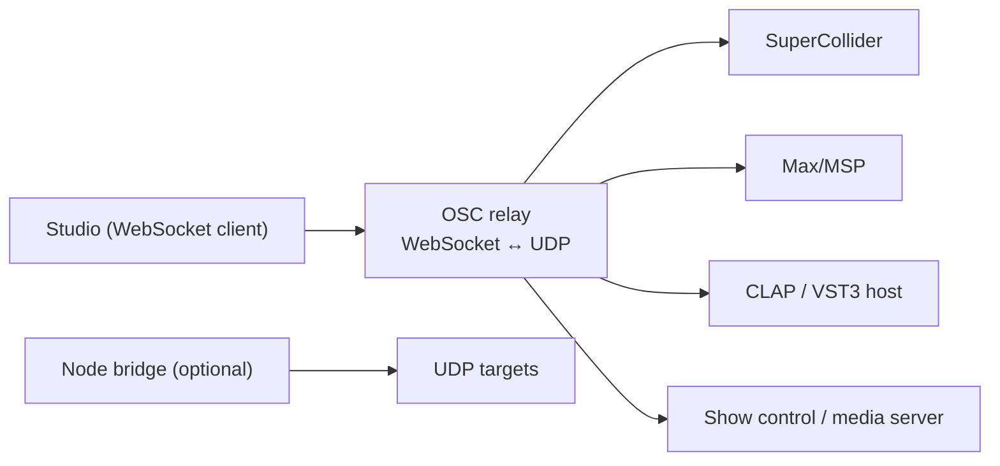

# OSC Bridge and Real-Time Control

`@aura-spec/osc-bridge` is the boundary between the authored project and the real-time audio world. It is deliberately small: a pure OSC 1.0 codec, a stable address space, a diff publisher, and adapters for Max/MSP, SuperCollider and a future CLAP/VST3 plugin.

```
packages/osc-bridge/src/codec.ts          OSC packets, bundles, timetags
packages/osc-bridge/src/address-space.ts  AURA addresses and session projection
packages/osc-bridge/src/bridge.ts         diff publisher, clock, transport
packages/osc-bridge/src/transports/       WebSocket (browser) + UDP (Node subpath)
packages/osc-bridge/src/adapters/         SuperCollider, Max, CLAP descriptors
```

---

## 1. Transport topology



The relay is implemented in `services/osc-relay` (`ws://localhost:8765` → `udp://127.0.0.1:9000`). The browser cannot send UDP directly, so the relay is a local, trusted service:

- accepts binary WebSocket frames containing OSC packets,
- validates size and rate,
- forwards to one or more UDP targets,
- optionally records a packet log for rehearsal replay.

A future relay should support:

- per-target rate limiting and backpressure,
- target health (no response ≠ failure for UDP; use heartbeat where available),
- bundle reassembly and timetag scheduling,
- mDNS discovery of local audio hosts,
- optional OSC Query for address discovery.

---

## 2. Address space

Default namespace: `/aura/v1`.

### 2.1 Session identity

```
/aura/v1/session/<sessionId>/...
```

`sessionId` and entity IDs are sanitised: characters outside `[A-Za-z0-9_.:-]` become `_`. This is intentional; OSC addresses are not a good place for arbitrary Unicode.

### 2.2 Sources

| Address | Args | Units / meaning |
|---|---|---|
| `/session/<id>/source/<sourceId>/position` | `x y z` | metres, world |
| `/session/<id>/source/<sourceId>/orientation` | `yaw pitch roll` | degrees, intrinsic Y-X-Z |
| `/session/<id>/source/<sourceId>/gain` | `dB` | source gain |
| `/session/<id>/source/<sourceId>/spread` | `deg` | spatial spread |
| `/session/<id>/source/<sourceId>/mute` | `0/1` | mute |
| `/session/<id>/source/<sourceId>/solo` | `0/1` | solo |
| `/session/<id>/source/<sourceId>/spatialization` | `string` | `object`, `hoa`, `vbap`, `dbap`, `wfs`, `binaural` |
| `/session/<id>/source/<sourceId>/trajectory/play` | `0/1` | trajectory active |
| `/session/<id>/source/<sourceId>/trajectory/loop` | `0/1` | loop |

### 2.3 Renderer

| Address | Args | Meaning |
|---|---|---|
| `/session/<id>/renderer/order` | `int` | HOA order 1–7 |
| `/session/<id>/renderer/mode` | `string` | primary renderer |
| `/session/<id>/renderer/sample-rate` | `int` | Hz |
| `/session/<id>/renderer/block-size` | `int` | samples |
| `/session/<id>/renderer/layout` | `string` | speaker layout label |

### 2.4 Speakers

| Address | Args | Meaning |
|---|---|---|
| `/session/<id>/speaker/<placementId>/drive` | `gainDb delayMs polarity` | per-speaker trim |
| `/session/<id>/speaker/<placementId>/position` | `x y z` | optional commissioning update |
| `/session/<id>/speaker/<placementId>/orientation` | `yaw pitch roll` | optional commissioning update |

### 2.5 Transport and clock

| Address | Args | Meaning |
|---|---|---|
| `/aura/v1/transport/playing` | `0/1` | transport |
| `/aura/v1/transport/bpm` | `float` | tempo |
| `/aura/v1/transport/position/beats` | `float` | musical position |
| `/aura/v1/transport/position/seconds` | `float` | seconds |
| `/aura/v1/transport/time-signature` | `int int` | numerator/denominator |
| `/aura/v1/clock` | `beats bpm playing` | heartbeat |

The clock is a **heartbeat**, not a sample-accurate timing source. For sample-accurate events, use bundle timetags and a renderer that schedules against its audio clock.

---

## 3. Codec

### 3.1 Supported types

- `f` — float32,
- `i` — int32,
- `s` — OSC string (UTF-8, null-padded to 4 bytes),
- `b` — blob (int32 size + bytes, padded),
- `T` / `F` — true/false,
- `t` — NTP timetag (64-bit).

### 3.2 Usage

```ts
import {
  encodeMessage,
  decodePacket,
  encodeBundle,
  oscInt,
  oscTimetag,
  timetagFromUnixSeconds,
} from '@aura-spec/osc-bridge'
// Node-only:
// import { UdpOscTransport } from '@aura-spec/osc-bridge/transports/udp'

const packet = encodeMessage('/aura/v1/.../position', [1, 2.5, -3])
const decoded = decodePacket(packet)

const bundle = encodeBundle(
  [packet],
  timetagFromUnixSeconds(Date.now() / 1000),
)
```

### 3.3 Timetags

OSC timetags count seconds since **1900-01-01**, not Unix epoch. The codec converts explicitly:

```ts
timetagFromUnixSeconds(1700000000.25)
timetagToUnixSeconds(timetag)
```

`IMMEDIATE_TIMETAG = 1n`. A bundle with timetag 1 is processed immediately.

### 3.4 Why not use an off-the-shelf OSC library?

The codec is small, dependency-free, deterministic and easy to audit. It also lets the browser studio encode OSC without a Node polyfill. If the project later needs OSC 1.1, pattern matching or advanced scheduling, wrap a proven library behind the same `OscTransport` interface.

---

## 4. Diff publisher

Sending every field at 60 Hz for 100 sources is wasteful and can destabilise the audio thread. `SessionDiffPublisher` compares the current projection with the last sent signature per address:

```ts
const publisher = new SessionDiffPublisher()
const changed = publisher.diff(session)   // first call: all fields
const again = publisher.diff(session)     // unchanged: []
```

`OscBridge` wraps the publisher:

```ts
const bridge = new OscBridge(transport, { bundle: true, timestampBundles: true })
bridge.startClock(() => session, 30)
await bridge.publishSession(session)
```

Rules:

- Diff by address and value signature.
- Publish at 30–60 Hz, not per animation frame.
- Bundle changed messages when the target supports timetags.
- Reset the publisher when a target reconnects or a user forces a full sync.
- Removed entities are not automatically deleted in M0; send an explicit mute/disable message or a full snapshot.

---

## 5. Adapters

### 5.1 SuperCollider

`generateSuperColliderReceiver(session)` returns a `.scd` snippet with exact OSCdefs for the session:

```ts
import { generateSuperColliderReceiver } from '@aura-spec/osc-bridge'
const scd = generateSuperColliderReceiver(session, { port: 9000 })
```

The generated code stores state in `IdentityDictionary`s. Replace the dictionary writes with your `Synth`/`Ndef` parameter updates.

See `examples/supercollider/aura_receiver.scd`.

### 5.2 Max/MSP

`maxRoutingTable(session)` returns a route table for `[coll]` / `[js]`:

```ts
import { maxRoutingTableAsJson } from '@aura-spec/osc-bridge'
console.log(maxRoutingTableAsJson(session))
```

Receive chain:

```
[udpreceive 9000] → [oscparse] → [route ...] → [unpack f f f]
```

Keep OSC callbacks allocation-free; schedule UI and heavy work with `[deferlow]` / `[qmetro]`.

See `examples/max/aura_receiver_notes.md`.

### 5.3 CLAP / VST3

`clapParametersForSession(session)` returns stable parameter descriptors:

```ts
interface ClapParameterDescriptor {
  id: number
  name: string
  module: 'source' | 'renderer' | 'master'
  min: number
  max: number
  defaultValue: number
  unit?: string
  stepped?: boolean
  toNormalized(value: number): number
  fromNormalized(value: number): number
}
```

The native plugin should:

- use the same coordinate convention and directivity data,
- consume OSC or share a control shared-memory region,
- apply parameter changes at block boundaries,
- enforce the session's SPL guardrails,
- expose a sample-aligned bypass.

See `examples/clap/aura_spatial_plugin.md`.

---

## 6. Latency and rate guidance

| Path | Typical rate | Notes |
|---|---|---|
| Source position (trajectory) | 30–60 Hz | Interpolate in the audio engine |
| Source gain/spread | 10–30 Hz | Smooth to avoid zipper noise |
| Renderer state | on change | Not per frame |
| Clock | 10–30 Hz | Heartbeat only |
| Speaker trim | on change | Commissioning |
| Sensor mapping | 1–10 Hz | Smooth in the mapping layer |

Latency budget (example, not a guarantee):

```
AD 0.5 ms + switch 2 × 0.15 ms + DSP 0.5 ms + DA 0.5 ms ≈ 1.8 ms
```

Add the Dante latency setting, host buffer and any wireless link. The budget must be declared in the project export.

---

## 7. Failure modes

| Failure | Detection | Behaviour |
|---|---|---|
| Relay down | WebSocket close/error | Studio shows `OSC error`; local preview continues |
| UDP target absent | No ACK (UDP has none) | Keep publishing at reduced rate; show "unconfirmed" |
| Packet burst | Queue depth / send time | Drop non-critical updates; preserve clock and transport |
| Clock drift | Phase error at the renderer | Use timetags; do not chase with OSC rate |
| Address mismatch | Target logs unknown address | Export the generated route table with the project |
| Unicode ID | Sanitised address | IDs are normalised; do not rely on raw Unicode |

---

## 8. Security

- Bind the relay to localhost by default. Exposing OSC/UDP to a public network is unsafe.
- Validate packet size (e.g., ≤ 64 kB) and rate per client.
- Never execute or eval OSC payloads.
- Treat source IDs as opaque; sanitise before using them in file paths or logs.
- Keep secrets (Dante keys, AI provider tokens) out of OSC and project files.

---

## 9. Test vectors

`packages/osc-bridge/tests/codec.spec.ts` verifies:

- float, int, string, bool, blob and timetag round-trip,
- type-tag string,
- time-tagged bundle round-trip,
- timetag conversion,
- stable source addresses,
- diff publisher emitting only changes.

Add an interoperability test against Max/SuperCollider before a venue deployment; the codec’s byte layout is standard, but host-specific scheduling is not.
