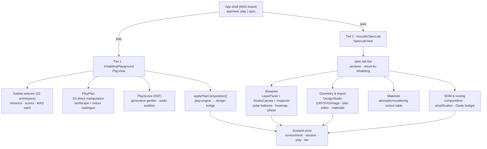

# Two-Tier Architecture: Inhabiting Playground ↔ Acoustic Spec Lab

**Status:** implemented (Tier 1 landing + Tier 2 lab + bridge)  
**Models:** `packages/inhabiting-model`  
**Tier 1 engine:** `packages/play-engine`  
**Tier 2 shell:** `apps/studio-web/src/spec/SpecLabView.tsx`

This platform is a **dual-state composition & specification environment**. It is not an acoustic CAD tool with a game skin, and not a game with hidden dB numbers. It is one coherent project seen through two states.

```
TIER 1 · INHABITING PLAYGROUND          TIER 2 · ACOUSTIC SPEC LAB
──────────────────────────────          ────────────────────────────
habitat archetypes                      physical plan ingestion
sound-object personae (dramatis)   ⇄    acoustic transducer specs (physics)
generative voices / audition            polar balloons · heatmaps · RT60
missions · scores · progression         materials · BOM · Dante/AES67/OSC
                     │
                     ├── openSpecLab(section)   → to-spec
                     └── returnToInhabiting()   → to-play
                          (tier state machine keeps revisions & dirty flags)
```

---

## 1. State machine

`packages/inhabiting-model/src/types.ts`

```ts
export type TierId = 'inhabiting' | 'spec-lab'
export type SpecLabSection = 'blueprint' | 'geometry' | 'materials' | 'bom'
export type TierTransition = 'idle' | 'to-spec' | 'to-play'

export interface TierState {
  tier: TierId
  specSection: SpecLabSection
  transition: TierTransition
  creativeRevision: number     // bumped on every Tier 1 edit
  technicalRevision: number    // bumped on every Tier 2 edit
  lastSyncedRevision: number | null
}
```

Transitions are pure functions: `openSpecLab(state, section)`, `returnToInhabiting(state)`, `markCreativeEdited`, `markTechnicalEdited`, `markTiersSynced`, plus dirty readers `creativeIsDirty` / `technicalIsDirty`.

The store owns one `TierState`. `openSpecLab` is the single legal door from Tier 1 to Tier 2; `returnToInhabiting` is the way back. Both bump revisions so the lab always knows whether the garden has changed since the last technical reading.

---

## 2. `HabitatArchetype`

Ten archetypes — five indoor inhabitation typologies, five outdoor horticultural typologies — each a complete preset:

```ts
export interface HabitatArchetype {
  id: string
  domain: 'indoor' | 'outdoor'
  typology:
    | 'domus-living' | 'gallery-vault' | 'intimate-alcove'
    | 'hyperresonant-hall' | 'transitional-corridor'
    | 'mediterranean-garden' | 'woodland-canopy' | 'mineral-zen-clearing'
    | 'water-basin-courtyard' | 'open-lawn-perimeter'
  site: { widthM: number; depthM: number; ceilingHeightM: number }
  acoustic: {
    targetT60S: number; absorptionBias: number; scatteringBias: number
    noiseFloorDb: number; intimacyDb: number; baseTempoBpm: number
    register: 'low' | 'mid' | 'high'
    density: number; brightness: number; roughness: number
  }
  landscape: { canopyCover; waterPresence; stonePresence; evergreenShare; objectMode }
  visual: { skyTop; skyHorizon; ground; fog; light; openness }
  parameterBias: { canopy; water; stone; light; guests; season; wind }
  recommendedPersonaKinds: PersonaKind[]
  invocation: string
}
```

| Domain | Archetypes |
|---|---|
| Indoor | Domus/Living · Gallery/Vault · Intimate Alcove · Hyper-resonant Hall · Transitional Corridor |
| Outdoor | Mediterranean Garden · Woodland/Canopy · Mineral/Zen Clearing · Water Basin/Courtyard · Open Lawn/Perimeter |

Selecting an archetype in the playground retunes the seven cross-domain parameters, switches the object catalogue (landscape/indoor), resizes the site and records `progress.habitatId` for the Tier 2 bridge.

---

## 3. `SoundObjectPersona` ↔ `AcousticTransducerSpec`

The creative identity and the physical device are two faces of the same object, joined by one binding.

```ts
export interface SoundObjectPersona {
  id: 'omni-cloud' | 'directional-voice' | 'asymmetric-lens'
    | 'sub-sculpture' | 'architectural-line'
  transducerProfileId: string          // → catalogue profile (polar, power, BOM)
  voice: {
    generator: 'ambient-bed' | 'harmonic-pad' | 'procedural-foley'
             | 'pulse' | 'spectral-drone'
    density; brightness; roughness; spreadDeg; gainDb; spatialization
  }
  visual: { color; shape: 'sphere'|'column'|'blade'|'lens'|'ground-plate'; scale }
}

export interface AcousticTransducerSpec {
  id: string
  personaKinds: PersonaKind[]
  manufacturer: string                 // Architettura Sonora / K-ARRAY
  model: string
  speakerProfileId: string             // catalogue: polar data, bands, files
  transducerClass: 'omnidirectional'|'directional'|'lens'|'subwoofer'|'line-array'
  sensitivityDbSpl1W1m: number
  maxSplDb: number
  powerHandlingW: number
  nominalImpedanceOhm: number
  dispersionDeg: { horizontal: number; vertical: number }
  ipRating: string
  polarSource: 'illustrative' | 'gll' | 'clf' | 'measured'
  mounting: string
}
```

Bridge:

```ts
personaToSpeakerIntent(placement, personas) → SpeakerIntent
personaSpeakerBindings(placements, personas, transducers) → binding[]
```

Every Tier 1 → Tier 2 transition resolves placed personae through this bridge; the transducer class drives the catalogue profile used for polar data, BOM and routing.

| Persona | Transducer class | Catalogue profile |
|---|---|---|
| omni-cloud | omnidirectional | `as-reference-omni-01` |
| directional-voice | lens | `as-reference-lens-01` |
| asymmetric-lens | lens | `as-reference-lens-01` |
| sub-sculpture | subwoofer | `karray-reference-sub-18` |
| architectural-line | line-array | `karray-reference-line-8` |

---

## 4. Frontend layout architecture



Landing sequence: the app boots with `appView: 'play'` (Tier 1). The user composes with habitats, objects, personae and parameters; "Flip to Technical Spec" applies the composition to the real environment/session and opens the lab at the blueprint. "Return to Inhabiting" goes back without losing either state.

---

## 5. Test matrix (this mandate)

| Test file | Protects |
|---|---|
| `inhabiting-model/tests/inhabiting-model.spec.ts` | 5+5 archetypes, all mandate typologies, complete presets, persona↔transducer bindings, tier state machine + dirty tracking |
| `play-engine/tests/habitat-persona.spec.ts` | habitat application, legacy-storage defaults, persona persistence, persona→profile mapping in the bridge intent |
| existing play/design/landscape suites | no regression in the cross-domain engine |

Current suite: **136 tests, 21 files, all passing.**

---

## 6. Non-goals

- No certified GLL/CLF import yet (polar source stays `illustrative` until real files land).
- No server-side brief submission yet (local persistence + export; hook documented in `docs/10-gamification.md`).
- The Web Audio audition is a prototype layer, not the shipping spatial renderer; the authoritative output remains the session/OSC pipeline.

---

## 7. Landing copy, workspace and correspondence

- The Tier 1 landing uses the bilingual statement:
  - **IT** — *Lo spazio immersivo sperimentale si esplora attraverso e con una partitura viva. Lo spazio giocabile è immediato.*
  - **EN** — *The experimental immersive space is explored through and with a living score. The playable space is immediate.*
  - audience line: *Per architetti · designer · developer · musicisti — integriamo, non sostituiamo.* / *For architects · designers · developers · musicians — we integrate, we do not replace.*
- **Area di lavoro** expands the spatial canvas to almost the full viewport (desktop: 446px → 851px in the reference layout), hiding the mission/parameters/tools only while working. Exit returns to the garden composition.
- **Correspondence**: `applyPlayComposition()` is the mandatory bridge. It updates `environment`, `session`, `designItems`, `architectureIntent` and the soundscape plan from the same play objects. The Spec Lab shows a sync row (`spec-sync-row`) with the Inhabiting object count, speaker count and technical element count; if the play state has unapplied changes it offers **Sincronizza ora**.
- **Bidirectional placement**: moving a `play-speaker-*` in the Spec Lab inspector writes the new plan position/rotation back to the corresponding Play object and marks the tiers synced. Other technical values (gain, delay, DSP) remain specification-layer values and do not mutate the creative object.
